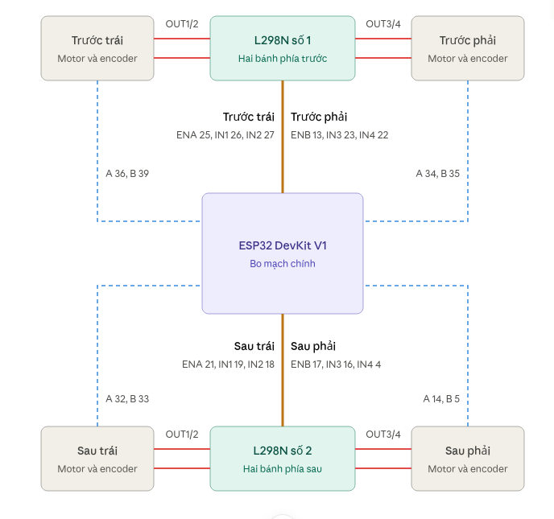

# AI-Powered Omni Robot

Robot omni 4 bánh (bánh chéo 45°) điều khiển bằng cử chỉ tay qua camera laptop.

**Bản 2 (`v2.0`):** điều khiển toàn bộ bằng hai tay. Tay không thuận lái robot như bản 1.
Tay thuận điều khiển giao diện: di con trỏ, click, kéo thanh trượt và cần lái, xem thông số, đổi chế độ,
mở cài đặt, ẩn hình camera. Báo cáo đầy đủ ở `reports/` (mục Báo cáo bên dưới).

## Phiên bản 1 (`v1.0`): nhận diện ngón tay để điều khiển robot omni

Camera laptop -> MediaPipe (21 điểm bàn tay) -> phân loại cử chỉ bằng luật hình học -> lọc nhiễu,
giới hạn gia tốc -> UDP qua WiFi do ESP32 phát -> động học omni -> PID 4 bánh (encoder 8112 xung/vòng).

Kết quả đo trên robot thật (sàn nhà, tốc độ 22-88%):

| Hạng mục | Kết quả |
|---|---|
| Camera / AI | 30 khung/giây, nhận diện tay 18 ms/khung (CPU) |
| Cử chỉ | 8 hướng chỉ + xoay + dừng; 7 lần chập chờn / 120 lần đổi cử chỉ |
| Độ trễ cử chỉ được chốt -> bánh đạt 50% tốc độ | trung vị 260 ms (204-359 ms) |
| WiFi laptop - ESP32 | trễ khứ hồi trung vị 8 ms, 95% dưới 26 ms |
| Bám tốc độ từng bánh (PID) | sai số trung bình 1.5-3% tốc độ tối đa |
| Chuyển động robot so với lệnh (từ encoder) | lệch 0.5-2.5%, xoay ngoài ý muốn khi đi thẳng < 0.003 |

Dữ liệu gốc: `docs/data/v1/` (log chạy thủ công và bằng cử chỉ). Tính lại các số trên:
`python tests/analyze_drive_log.py docs/data/v1/drive_gesture.csv`. Quay lại bản này: `git checkout v1.0`.

## Phiên bản 2 (`v2.0`): điều khiển bằng hai bàn tay

Tay thuận điều khiển giao diện web (con trỏ, click, kéo), tay không thuận lái robot, cùng một camera.
Ở chế độ Thủ công chỉ cần một tay. Phiên chạy hai tay trên sàn (266 s, 5020 dòng ghi 20 Hz) và các số đo lại:

| Hạng mục | Kết quả |
|---|---|
| Camera + nhận diện tay (đo 359 khung, chưa có tay trong khung) | 29,9 khung/giây, suy luận trung bình 18,5 ms (P95 27,1 ms) |
| WiFi laptop - ESP32 | RTT trung vị 6,6 ms, P95 16,1 ms, lớn nhất 909 ms |
| Từ lúc chốt cử chỉ đến khi bánh đạt 50% | trung vị 257 ms (203-309 ms); gồm giới hạn gia tốc có chủ ý |
| Bám tốc độ từng bánh | trung bình 2,3-2,6%; P95 6,1-7,4% (vượt mốc 5% ở đuôi) |
| Kiểm thử tự động | 46 (logic tay) + 49 (con trỏ trong trình duyệt), đều đạt |

**Kết quả âm trên tay thật:** bộ lọc One-Euro và cơ chế neo điểm click (`FREEZE_BACK`) trông hiệu quả trên bàn tay
mô phỏng (giảm rung 65,5%, giảm lệch click 83,6%) nhưng trên tay thật (một người, 12 lần click) rung chỉ giảm 5%
và neo không giảm độ lệch (ngón trỏ dịch trung vị 1,65 px, điểm tác động 4,15 px). Số chi tiết và giới hạn ở báo cáo.

Dữ liệu: `docs/data/v2/`. Tính lại: `python tests/analyze_drive_log.py docs/data/v2/drive_twohand.csv`.
Quay lại bản này: `git checkout v2.0`.

## Báo cáo

`reports/` có hai tài liệu, mỗi tài liệu hai bản (tiếng Anh và tiếng Việt), kèm PDF đã dựng:

| Tài liệu | Nguồn LaTeX |
|---|---|
| Bài nghiên cứu (bản tiếng Anh: mẫu tạp chí Elsevier `elsarticle`; bản tiếng Việt: mẫu IEEE hội nghị) | `reports/research_paper/paper_en.tex`, `paper_vi.tex` |
| Tài liệu kỹ thuật và thiết kế hệ thống | `reports/technical_document/report_en.tex`, `report_vi.tex` |

Mọi hình và con số lấy từ dữ liệu trong `docs/data/` bằng `python reports/make_figures.py`
(hình trong `reports/figures/`, số trong `reports/figures/stats.json`).
Phiên chạy thứ hai (bốn phiên server có tay thật, log trong `docs/data/v2/session2/`) do `python reports/session2.py` xử lý, ra `reports/figures/stats_session2.json` và hình `fig_sess2_*`; từng phiên đọc bằng `python tests/analyze_run.py logs/ai_<giờ>.csv logs/drive_<giờ>.csv`. Dựng lại PDF cần TeX Live
(`latexmk -pdf paper_en.tex`) hoặc Tectonic; bản tiếng Việt nên dùng `xelatex`. Tác giả bài nghiên cứu bản tiếng Anh: Tai Nguyen Anh (Information Systems, Phenikaa University, Hà Nội), Raunak Raj và Sharma B. S S P M (Parul University, Vadodara, Ấn Độ); email và tác giả liên hệ (corresponding author) chưa điền. Bản tiếng Việt vẫn còn để trống cơ quan.

`explain/` có hai file Word giải thích bài nghiên cứu và cách đọc từng biểu đồ: `Giai_thich_paper_VI.docx` (tiếng Việt) và `Paper_Explained_EN.docx` (tiếng Anh đơn giản). Tạo lại bằng `python explain/build_guides.py` (cần `python-docx`) sau khi chạy lại `reports/make_figures.py`.


## Cài đặt

```bash
python3 -m venv .venv && source .venv/bin/activate
pip install -r requirements.txt
```

Firmware dùng [PlatformIO](https://platformio.org/). Nạp firmware chính (cắm ESP32 qua USB):

```bash
cd firmware
pio run -t upload
```

## Chạy

```bash
nmcli device wifi connect omni-robot password omnirobot   # bật robot trước, không cần Internet
python web/server.py                                       # mở http://127.0.0.1:8000/
```

Ô "Robot" xanh là đã kết nối. Xong thì nối lại WiFi cũ: `nmcli connection up "<tên WiFi>"`.

## Cử chỉ

Ảnh đã lật gương: "trái" là bên trái của bạn. Hai tay độc lập, dùng cùng lúc được. Mặc định tay phải
điều khiển giao diện, tay trái lái robot (đổi trong Cài đặt).

Chế độ **Thủ công** chỉ cần một tay: tay nào đang thấy cũng điều khiển giao diện, kể cả kéo cần lái.
Chế độ **Cử chỉ tay** mới chia vai theo bên.

**Tay không thuận: lái robot** (bật bằng nút **Cử chỉ tay**)

| Cử chỉ | Robot |
|---|---|
| Ngón trỏ chỉ 8 hướng | Đi theo hướng chỉ |
| Chữ V chỉ trái / phải | Xoay trái / phải |
| Nắm tay, xòe tay, không thấy tay | Dừng |

**Tay thuận: giao diện**

| Cử chỉ | Tác dụng |
|---|---|
| Chỉ ngón trỏ | Di con trỏ |
| Giữ yên con trỏ trên nút (0.8 s, vòng tròn đầy dần) | Click |
| Giữ yên trên thanh trượt | Nắm thanh (viền xanh, giá trị không nhảy). Di ngón tay thì giá trị tăng giảm theo; dừng yên để nhả |
| Duỗi thêm ngón giữa | Bấm nhanh; giữ rồi di chuyển là kéo thanh trượt (cũng tương đối) hoặc cần lái |
| Rê lâu (0.5 s) lên nút hoặc chip trạng thái | Hiện thẻ thông số |
| Tư thế khác (xòe, nắm...) | Con trỏ ẩn, không bấm nhầm |

Nút **Dừng khẩn cấp** (phím Space) luôn dừng ngay. ESP32 tự dừng nếu mất lệnh quá 0.3 s.
Giơ tay trước camera 2 giây khi chưa mở dashboard thì trình duyệt tự mở (tắt: `HAND_OPEN=0`).

**Chạm góc màn hình:** con trỏ trùng đầu ngón tay ở giữa khung camera (±10%), xa hơn thì lệch tăng dần (đường cong mượt, không có điểm gãy,
tốc độ tối đa khoảng 1,35 lần tay), nên chạm được góc màn hình (ví dụ thanh tốc độ) khi đầu ngón còn cách mép khung 6%,
tay không phải ra ngoài khung nên không bị mất. Nếu tay vẫn mất đúng ở mép thì con trỏ được giữ lại tối đa 1 giây.

**Độ nét:** hình lấy 1280x720 (camera trên máy này hỗ trợ MJPG 30 fps ở độ phân giải đó), AI vẫn nhận diện trên bản thu về 640 px.
Camera không có độ phân giải này thì đặt `CAMERA_WIDTH` và `CAMERA_HEIGHT` (ví dụ 640 và 480), hoặc xem chế độ camera hỗ trợ bằng
`v4l2-ctl --list-formats-ext -d /dev/video0`.

## Nhật ký mỗi lần chạy

Chạy `python web/server.py` là tự ghi, không cần cờ gì. Thư mục `logs/` (bị gitignore) có, cho mỗi lần chạy:

| Tệp | Nội dung |
|---|---|
| `run_<giờ>.log` | **Toàn bộ chữ server in ra** (kể cả cảnh báo của MediaPipe, OpenCV, uvicorn), mỗi dòng có giờ. Có phần đầu (mã git và có sửa chưa commit hay không, máy, phiên bản thư viện), các sự kiện (đổi chế độ, dừng khẩn cấp, đổi tốc độ, robot nối hoặc mất, camera, dashboard mở hoặc đóng), một dòng thống kê mỗi 5 giây (fps, thời gian suy luận, RTT, số tay) và tóm tắt cuối phiên |
| `ai_<giờ>.csv` | Mỗi khung camera một dòng: giờ, thời gian suy luận, số tay, tư thế con trỏ, cử chỉ đã lọc, lệnh cử chỉ, vị trí con trỏ |
| `drive_<giờ>.csv` | 20 Hz, chỉ khi robot nối: lệnh gửi đi, RTT, tốc độ đặt, tốc độ đo (encoder) và PWM của 4 bánh |

`ai_*.csv` và `drive_*.csv` dùng chung đồng hồ `time.time()` nên ghép được để tính độ trễ từ khung camera đến bánh xe. Đọc nhanh:
`tail -f logs/run_*.log` khi đang chạy, hoặc `python tests/analyze_drive_log.py logs/drive_<giờ>.csv` sau khi chạy.

## Công cụ kiểm tra

Kê robot lên (bánh không chạm đất) trước khi chạy motor.

| Lệnh | Việc |
|---|---|
| `pio run -e motor_test -t upload -t monitor` | Gõ `1`-`4` chạy từng bánh, `t` đo tốc độ tối đa và vùng chết |
| `pio run -t upload -t monitor` | Firmware chính. Gõ `s` chạy kịch bản thử, `g kp ki ff` đổi hệ số PID |
| `pio device monitor` | Chỉ xem Serial, không nạp lại |
| `python ai/demo.py` | Xem AI nhận hai tay, vai trò và con trỏ (`left` nếu thuận tay trái) |
| `python tests/test_hands_logic.py` | Kiểm tra logic tay bằng bàn tay giả, không cần camera |
| `python tests/real_hand_eval.py` | Đo rung và độ lệch khi click trên bàn tay thật (tắt server trước; giữ yên ngón tay theo hướng dẫn) |
| `tests/handcursor_test.html` | 49 kiểm tra con trỏ trong trình duyệt: phục vụ thư mục gốc bằng `python -m http.server`, mở trang này (cửa sổ cao trên 500 px) |
| `python communication/robot_link.py` | Gửi lệnh thử tới ESP32 (khi không chạy server) |

Lệnh `pio` chạy trong thư mục `firmware/`. Thoát bằng Ctrl+C.

## Phần cứng

ESP32 DevKit V1, 2 driver L298N, 4 motor GM25-370 (1:78, encoder 8112 xung/vòng bánh, cấp 3.3 V), nguồn 12 V.



| Bánh | PWM | IN1 | IN2 | Encoder A | Encoder B |
|---|---|---|---|---|---|
| Trước trái | 25 | 26 | 27 | 36 | 39 |
| Trước phải | 13 | 23 | 22 | 34 | 35 |
| Sau trái | 21 | 19 | 18 | 32 | 33 |
| Sau phải | 17 | 16 | 4 | 14 | 5 |

## Thư mục

| | |
|---|---|
| `ai/` | `camera.py`, `hands.py` (2 tay, vai trò), `drive/` (cử chỉ lái), `ui/` (con trỏ) |
| `web/` | server và dashboard |
| `communication/` | gửi lệnh tới ESP32 qua UDP |
| `firmware/` | ESP32: WiFi, động học omni, PID |
| `tests/` | đo FPS camera, phân tích log, kiểm thử con trỏ, đo trên tay thật |
| `docs/` | sơ đồ chân, dữ liệu đo bản 1 và bản 2 |
| `reports/` | bài nghiên cứu và tài liệu kỹ thuật (LaTeX, tiếng Anh và tiếng Việt), script sinh hình |
| `explain/` | file Word giải thích bài nghiên cứu và các biểu đồ (tiếng Việt, tiếng Anh) |
